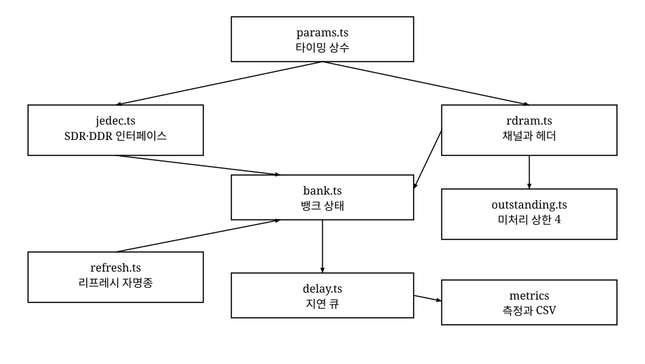
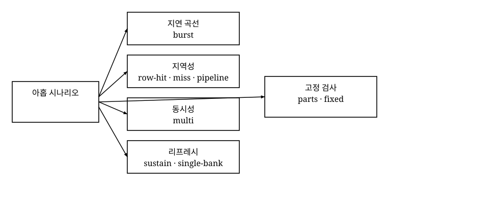
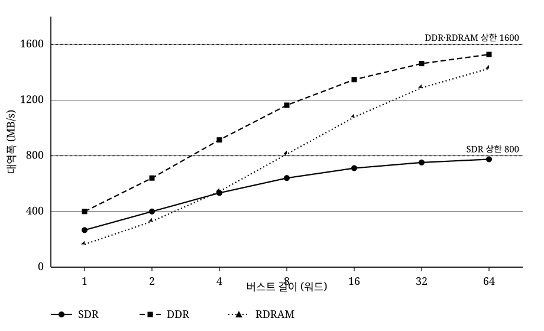
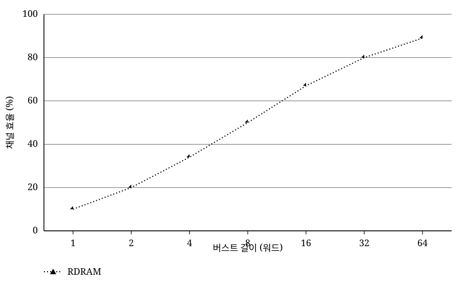
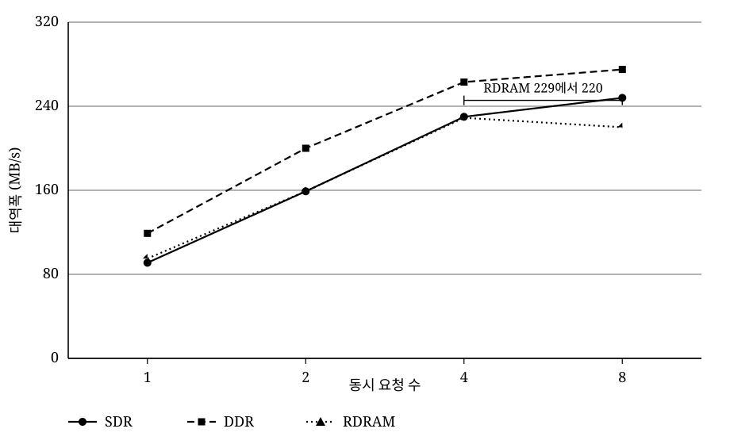
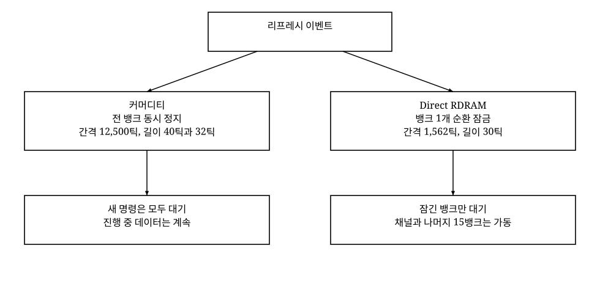

양식 메모. Word로 옮길 때 A4 2단, 본문 바탕체 9pt, 줄 간격 130%, 단락 들여쓰기 0.4cm를 적용한다. 수식은 가운데에 두고 번호는 오른쪽에 둔다. 아래 수식은 그 배치를 마크다운으로 적어 둔 것이다. 그림은 백색 바탕과 흑색 선이다.

## 2. 시나리오 실험

### 2.1 실험 대상 모델과 파라미터

이 절의 질문은, 같은 DRAM 코어 위에서 인터페이스만 바꾸면 무엇이 달라지는가이다.

본 연구는 하나의 DRAM 코어를 SDR SDRAM, DDR SDRAM, Direct RDRAM 세 인터페이스로 구동하는 틱 단위 시뮬레이터를 구현하였다. 시간은 실수 나노초가 아니라 정수 틱이다. 1틱은 1.25 ns이다. 커머디티 계열의 클록은 8틱, 곧 10 ns이다. Direct RDRAM의 클록은 2틱, 곧 2.5 ns이다. 정수 틱은 이 세 클록을 한 축에 놓는 공통 단위이다. 무작위 주소가 필요한 시나리오는 시드 7로 고정하여 같은 입력을 다시 돌릴 수 있게 하였다.

시뮬레이터는 네 가지 전제 위에서 동작한다. 첫째, 타이밍 파라미터는 Cuppu와 Jacob 등의 2001년 표[2]를 따른다. 둘째, 미처리 요청의 상한은 4이다. 이 상한은 Crisp의 Direct RDRAM 기술 개관[3]이 적은 기기당 최대 네 요청에서 가져왔다. 셋째, 커머디티 DRAM의 리프레시 간격은 ISSI 데이터시트[5]와 Davis의 논문[4]이 같이 적는 값이다. 64 ms 동안 4,096회이고, 간격은 12,500틱이다. 넷째, Direct RDRAM의 간격은 처음에 33 ms를 4,096으로 나눈 6,446틱으로 두었다. 2.6절에서 서술하듯, Samsung KM416RD8AC 데이터시트[6]의 REFA 주기에 따라 이 값은 1,562틱으로 바뀌었다.

그림의 상자는 그 전제를 코드 모듈로 나눈 것이다. `params.ts`가 타이밍 상수를 들고, `jedec.ts`와 `rdram.ts`가 같은 `bank.ts`를 다른 문으로 부른다.

그림 1. 시뮬레이터의 모듈 구조 / Fig. 1. Module structure of the simulator.

표 1. 인터페이스별 타이밍 파라미터 / Table 1. Per-interface timing parameters

| 항목 | SDR | DDR | RDRAM |
| --- | --- | --- | --- |
| 코어 클록 | 100 MHz | 100 MHz | 400 MHz |
| 프리차지 tRP | 20 ns, 16틱 | 20 ns, 16틱 | 20 ns, 16틱 |
| 행 접근 | 30 ns, 24틱 | 20 ns, 16틱 | 17.5 ns, 14틱 |
| 열 접근 | 30 ns, 24틱 | 20 ns, 16틱 | 30 ns, 24틱 |
| 워드당 전송 | 10 ns, 8틱 | 5 ns, 4틱, 양 에지 | 16비트 채널, 2틱 클록 |
| 뱅크 수 | 4 | 4 | 16 |
| 미처리 상한 | 없음 | 없음 | 4 |

표 1의 값은 모두 틱으로 환산한 뒤 정수로만 계산한다. 행 접근 시간은 Cuppu 표의 구성 요소이다. 데이터시트의 tRCD와 같은 칸이 아니다. SDR과 DDR은 ISSI 진리표[5]의 핀 명령으로 명령을 받는다. Direct RDRAM은 행 패킷과 열 패킷이 채널을 점유한 뒤에 데이터가 따르는 패킷으로 모델링하였다.

### 2.2 시나리오 설계

이 절의 질문은, 어떤 요청 흐름에서 어떤 양을 재는가이다.

하나의 시나리오는 요청 흐름, 조건, 관측 대상으로 정의된다. 본 연구는 아홉 시나리오를 다섯 갈래로 묶었다. 그림 2가 그 갈래이다. 표 2가 각 시나리오의 조건과 관측 대상이다.

그림 2. 시나리오 설계도 / Fig. 2. Scenario taxonomy.

표 2. 시나리오 요약 / Table 2. Scenario summary

| 시나리오 | 조건 | 관측 대상 |
| --- | --- | --- |
| burst | 열린 행, 버스트 1에서 64워드, 동시 1 | 첫 데이터까지 지연, 대역폭, 채널 효율 |
| row-hit | 요청 8개, 열린 행, 순차 | 요청당 지연 P50 |
| row-miss | 요청 8개, 닫힌 행, 순차 | 요청당 지연 P50 |
| pipeline | 요청 8개, 동시 4 | 지연 겹침, P50 |
| multi | 랜덤 주소, 버스트 1, 동시 1에서 8, 시드 7 | 대역폭의 동시성 의존 |
| parts | DDR, 버스트 4와 64 | 대역폭과 지연 구성 요소의 분리 |
| fixed | 닫힌 행 1회 읽기 | 첫 데이터까지 시간 |
| sustain | 요청 2,048개, 버스트 8, 동시 8, 시드 7, 리프레시 끔과 켬 | 리프레시가 완료 시각에 미치는 영향 |
| single-bank | 단일 뱅크에 버스트 8 요청 160회, 리프레시 켬 | 뱅크 단위 잠금의 실지연 |

모든 시나리오는 2,000,000틱 관측 한계 안에서 끝난다. 결과는 CSV로 남고, 표와 그래프는 그 파일과 README에 적힌 관측만 인용한다. 성능표를 손으로 채워 넣지 않는다.

CSV에서 parts의 DDR 대역폭은 버스트 4에서 914 MB/s, 버스트 64에서 1,528 MB/s이다. fixed의 완료 틱은 SDR 48, DDR 32, RDRAM 61이다. 이 두 시나리오의 자세한 분해는 2.3절의 닫힌 식과 같은 파라미터에서 나온다.

### 2.3 버스트 길이에 따른 지연과 대역폭

이 절의 질문은, 이미 열린 행에서 버스트만 늘리면 지연과 대역폭이 어떻게 갈라지는가이다.

열린 행에서 버스트 길이 b의 읽기 지연은 인터페이스마다 하나의 식으로 닫힌다. SDR은 첫 열 접근 24틱 뒤에 워드마다 8틱이 더해진다. DDR은 같은 클록의 상승과 하강에서 워드를 내보내므로 추가 워드가 4틱이다. Direct RDRAM은 행 패킷과 열 패킷의 고정분 32틱 뒤에, 128비트 내부 묶음을 16비트 채널로 8대 1로 내보낸다.

LSDR(b) = 24 + (b - 1) × 8 &nbsp;&nbsp;&nbsp;&nbsp; (1)

LDDR(b) = 16 + (b - 1) × 4 &nbsp;&nbsp;&nbsp;&nbsp; (2)

LRDRAM(b) = 32 + ceil(8b / 16) × 8 - 1 &nbsp;&nbsp;&nbsp;&nbsp; (3)

b = 8이면 지연은 SDR 80틱, 100 ns이다. DDR은 44틱, 55 ns이다. RDRAM은 63틱, 78.75 ns이다. 표 3은 CSV의 burst 행이다. 지연 칸은 그 행의 완료 틱과 같고, 식 (1)에서 (3)과도 같다.

표 3. 버스트 길이별 지연, 대역폭, 효율 / Table 3. Latency, bandwidth, and efficiency by burst length

| b | SDR 지연 | DDR 지연 | RDRAM 지연 | SDR MB/s | DDR MB/s | RDRAM MB/s | SDR 효율 | DDR 효율 | RDRAM 효율 |
| --- | --- | --- | --- | --- | --- | --- | --- | --- | --- |
| 1 | 24 | 16 | 39 | 266 | 400 | 164 | 33% | 25% | 10% |
| 2 | 32 | 20 | 39 | 400 | 640 | 328 | 50% | 40% | 20% |
| 4 | 48 | 28 | 47 | 533 | 914 | 544 | 66% | 57% | 34% |
| 8 | 80 | 44 | 63 | 640 | 1163 | 812 | 80% | 72% | 50% |
| 16 | 144 | 76 | 95 | 711 | 1347 | 1077 | 88% | 84% | 67% |
| 32 | 272 | 140 | 159 | 752 | 1462 | 1288 | 94% | 91% | 80% |
| 64 | 528 | 268 | 287 | 775 | 1528 | 1427 | 96% | 95% | 89% |

지연의 순서는 b = 4에서 바뀐다. b = 1과 b = 2에서 SDR은 24틱과 32틱이고, RDRAM은 둘 다 39틱이다. b = 3은 CSV의 burst 행이 아니다. 식 (1)과 식 (3)은 그때 SDR 40틱, RDRAM 47틱을 준다. b = 4에서 SDR은 48틱, RDRAM은 47틱이다. 그 뒤의 표 3 행에서는 RDRAM이 SDR보다 짧다. 짧은 버스트에서 RDRAM이 긴 이유는 32틱 헤더가 고정 비용이기 때문이다. 버스트가 길어지면 그 비용이 여러 워드로 나뉜다.

그림 3은 표 3의 대역폭 세 줄을 한 축에 그린 것이다. 점선은 이 모델의 상한이다. SDR은 틱당 1바이트라 800 MB/s이고, DDR과 RDRAM은 틱당 2바이트라 1,600 MB/s이다. 세 곡선은 버스트가 길어질수록 각 상한을 향해 올라가고, 중간에 내려가는 점은 없다. DDR이 전 구간에서 가장 높다.

그림 3. 버스트 길이에 따른 대역폭 / Fig. 3. Bandwidth versus burst length.

그림 4는 표 3의 RDRAM 효율만 따로 그린 것이다. 효율은 10%에서 89%로 올라가고, 늘어나는 폭은 줄어든다. 헤더 틱은 고정이므로, 길이가 늘수록 남는 손실은 채널이 낼 수 있는 1,600 MB/s 쪽에 남는다.

그림 4. 버스트 길이에 따른 RDRAM 채널 효율 / Fig. 4. RDRAM channel efficiency versus burst length.

### 2.4 페이지 지역성과 파이프라인

이 절의 질문은, 같은 행을 다시 읽을 때와 매번 다른 행을 열 때 지연이 얼마나 벌어지는가이다.

row-hit는 열린 행을 다시 읽는다. row-miss는 매번 다른 행을 연다. 열린 행을 다시 읽으면 행 접근 비용을 다시 내지 않는다. 그래서 세 인터페이스 모두에서 row-hit의 P50이 row-miss보다 짧다. pipeline은 같은 열린 행 요청 8개를 동시 4로 넣어, 앞 전송이 핀을 쓰는 동안 다음 명령이 겹치는지를 본다. 표 4가 그 P50과 최대 겹침이다.

표 4. 지역성과 파이프라인 시나리오의 지연, P50, 틱 / Table 4. Median latency under locality and pipeline scenarios

| 시나리오 | SDR | DDR | RDRAM |
| --- | --- | --- | --- |
| row-hit | 87 | 47 | 63 |
| row-miss | 127 | 79 | 85 |
| pipeline, 동시 4 | 255 | 127 | 159 |
| 최대 겹침 | 24 | 16 | 21 |

열린 행이 닫힌 행보다 짧은 점은 세 인터페이스에서 같다. 미스에서 늘어난 P50은 SDR 40틱, DDR 32틱, RDRAM 22틱이다. RDRAM의 증가가 가장 작다. 행 접근이 14틱으로 가장 짧기 때문이다. 절대 지연의 순위는 버스트 8의 길이를 따른다. row-hit에서 RDRAM 63틱은 SDR 87틱보다 짧다. row-miss에서도 RDRAM 85틱은 SDR 127틱보다 짧다. 이 순위는 2.3절에서 b가 4 이상일 때 RDRAM이 SDR보다 짧아진 결과와 맞다.

pipeline의 P50이 긴 것은 워드 하나의 지연이 길어진 결과가 아니다. 동시 4 요청이 한 줄로 재배열된 결과이다. 그 상태의 스트림 대역폭은 SDR 742 MB/s, DDR 1,442 MB/s, RDRAM 1,201 MB/s이다. 표 4의 최대 겹침은 세 인터페이스 모두 0보다 크다. 겹침이 있어도 대역폭 순위는 DDR, RDRAM, SDR이다.

### 2.5 동시성 증가에 따른 대역폭

이 절의 질문은, 랜덤 주소에서 동시에 넣는 요청을 늘리면 대역폭이 계속 오르는가이다.

multi는 시드 7의 랜덤 주소, 버스트 1에서 동시 요청을 1, 2, 4, 8로 늘린다. 표 5와 그림 5가 그 대역폭이다. SDR과 DDR은 동시성이 늘수록 대역폭이 오른다. RDRAM은 동시 4의 229 MB/s까지 오른 뒤, 동시 8에서 220 MB/s로 내려간다.

표 5. 동시성별 대역폭, MB/s / Table 5. Bandwidth versus concurrency

| 동시 요청 | SDR | DDR | RDRAM |
| --- | --- | --- | --- |
| 1 | 91 | 119 | 95 |
| 2 | 159 | 200 | 159 |
| 4 | 230 | 263 | 229 |
| 8 | 248 | 275 | 220 |

RDRAM의 뱅크는 16개로 가장 많다. 랜덤 주소에서는 행 미스마다 행 패킷과 열 패킷을 낸다. 채널이 그 패킷으로 찬 뒤에는 남은 뱅크가 그 병목을 지우지 못한다. 그림 5의 괄호는 동시 4에서 동시 8로 가는 RDRAM 구간을 표시한다. DDR은 표 3과 같은 1,600 MB/s 상한 쪽에서 동시성의 이득을 더 받는다. 표 5의 네 칸 모두에서 DDR이 가장 높다.

그림 5. 동시 요청 수에 따른 대역폭 / Fig. 5. Bandwidth versus concurrency.

### 2.6 리프레시, 두 방식의 간섭 비교

이 절의 질문은, 리프레시를 켜면 완료 시각이 얼마나 밀리는가이다.

DRAM 셀의 전하는 새므로 주기적인 재충전이 필요하다. 커머디티 DRAM은 한 번의 리프레시 동안 모든 뱅크가 새 활성화, 읽기, 프리차지를 함께 멈춘다. Direct RDRAM은 내부 뱅크를 하나씩 돌아가며 잠근다[1]. 그림 6이 그 차이다. 커머디티는 잠금 동안 새 명령을 모두 막는다. RDRAM은 잠긴 뱅크 하나만 막고, 채널과 나머지 15개 뱅크는 남긴다. 이미 나가던 데이터는 어느 쪽이든 계속 나간다. 잠금 한 번의 길이는 프리차지와 행 접근의 합이다. SDR은 40틱, DDR은 32틱, RDRAM은 30틱이다.

그림 6. 전 뱅크 정지와 뱅크 순환 잠금 / Fig. 6. Ganged refresh versus bank-rotating refresh.

초기 모델의 RDRAM 간격은 데이터시트와 달랐다. 처음에는 33 ms를 4,096으로 나눈 6,446틱을 가정하였다. 4,096은 커머디티 규격[4], [5]의 횟수이고, RDRAM 문헌에서 확인된 횟수가 아니었다. Samsung KM416RD8AC, 128/144M Direct RDRAM, 데이터시트[6]는 REFA의 평균 간격을 다음으로 정한다.

tREFA = tREF / 2(BBIT+RBIT) &nbsp;&nbsp;&nbsp;&nbsp; (4)

Table 19의 tREF는 32 ms이다. 그 다이의 구성은 2×16 뱅크와 행 주소 9비트이므로, 32 ms를 16,384로 나눈다. 32 ms는 25,600,000틱이다. 16,384로 나누면 1,562.5틱이다. tREF는 넘기면 안 되는 상한이므로 간격은 1,562틱으로 내림하였다. 6,446을 1,562로 나누면 4.127이고, 이벤트는 초기 가정보다 약 4.1배 잦다. 64/72M 계열은 같은 32 ms를 8,192로 나누어 3,125틱이다. 본 모델은 비교 대상으로 둔 128 Mbit 규격을 따랐다.

sustain은 요청 2,048개, 버스트 8, 동시 8, 시드 7의 포화 스트림이다. 리프레시를 끈 행과 켠 행을 표 6에서 비교한다.

표 6. sustain 시나리오 결과 / Table 6. Sustained-stream results with refresh off and on

| 지표 | SDR | DDR | RDRAM |
| --- | --- | --- | --- |
| 총 틱, 끔 / 켬 | 131,112 / 131,112 | 65,564 / 65,564 | 109,645 / 109,703 |
| 대역폭 MB/s, 끔 / 켬 | 799 / 799 | 1599 / 1599 | 956 / 955 |
| 리프레시 이벤트 / 바쁜 틱 | 10 / 400 | 5 / 160 | 70 / 2,100 |
| 추가 지연 평균 / 최대, 틱 | 0 / 0 | 0 / 32 | 0 / 32 |

표 6에서 세 가지가 보인다. 첫째, SDR과 DDR은 리프레시를 켜도 총 완료 틱이 움직이지 않는다. 스케줄러가 핀이 바쁜 동안 다음 열 명령을 미리 내는 여유가, 잠금 한 번보다 길기 때문이다. SDR은 시작이 40틱 밀려도 핀이 비기 전에 도착하므로 완료 시각이 같다. DDR은 요청 순서가 최대 32틱 바뀌지만, 그 쌍이 서로 상쇄되어 평균 추가 지연은 0이고 완료 틱도 같다. 둘째, RDRAM은 이벤트가 70회이고 바쁜 틱이 2,100이다. 잠긴 뱅크는 하나이다. 총 완료 틱은 109,645에서 109,703으로 58틱 밀린다. 대역폭 정수는 956 MB/s에서 955 MB/s로 1 내려간다. 셋째, 최악 추가 지연은 DDR과 RDRAM이 32틱으로 같다. 이 시드의 포화 스트림에서는 뱅크 하나만 잠그는 쪽의 최악 지연이 더 작다고 말할 수 없다. 이것은 일반 증명이 아니다. 채널이 이미 찬 스트림에서는 뱅크 잠금의 대기가 그 병목 뒤에 숨는다는 이 시드의 관측이다.

single-bank는 버스트 8 요청 160회를 뱅크 하나에 넣는다. CSV의 추가 지연 최댓값은 0이다. 잠금이 1,562틱 시점의 전송 구간에 겹친 위상 결과이다. 잠금이 언제나 공짜라는 뜻은 아니다. 점유율은 SDR 0.32%, 40/12,500이다. DDR은 0.26%, 32/12,500이다. RDRAM은 1.92%, 30/1,562이다. RDRAM은 이벤트는 잦고, 한 번의 길이는 30틱이다.

리프레시 간격을 1,562틱에서 ±50%로 움직여도 결론은 바뀌지 않는다. 간격을 781틱으로 줄이면 이벤트는 140회, 잠금은 4,200틱이고 총 틱은 109,883으로 늘어나며, 2,343틱으로 늘리면 46회, 1,380틱, 109,875이다. 어느 쪽도 총 틱 증가는 0.3% 이내이고 대역폭은 954 MB/s를 밑돌지 않는다. 다만 최악 추가 지연은 간격의 위상을 따라가므로 32틱이 일반적인 상한은 아니다. 781틱에서는 최악이 1,285틱까지, 2,343틱에서는 292틱까지 벌어진다. 단일뱅크의 추가 0도 같은 위상 효과로, 간격이 움직이면 단일뱅크는 28틱까지, 지속 시나리오는 위의 폭을 더한다.

동시 1로 400요청을 보낸 스트림은 CSV 행이 아니고 README에 있다. 명령이 임계 경로에 더 가깝다. 총 완료 틱의 증가는 SDR 48틱, 이벤트 4회이다. DDR은 8틱, 이벤트 2회이다. RDRAM은 28틱, 이벤트 23회이다. 최악 요청의 증가는 32틱, 8틱, 26틱이다. RDRAM의 최악 대기는 한 뱅크 리프레시 30틱 안에 있다.

### 2.7 결과의 검증

이 절의 질문은, 표의 숫자가 식과 CSV와 어디까지 같은가, 그리고 증명과 대조가 무엇을 확정하는가이다.

닫힌 식과 CSV를 먼저 대조하였다. 식 (1)에서 (3)을 표 3의 burst 길이 1, 2, 4, 8, 16, 32, 64에 넣으면, 세 인터페이스 21개 지연이 CSV의 완료 틱과 같다. 불일치는 0이다. 대조 스크립트는 `paper/figures/gen_figures.mjs`이다. b = 3의 40틱과 47틱은 이 21점에 들어 있지 않다. 그 둘은 식의 값이고, CSV에 burst 3 행은 없다.

버스트 지연의 닫힌 식은 b = 1부터 64까지 192개 지점, 세 아키텍처 × 64 버스트 길이에서 시뮬레이터와 대조하였다. 대조 스크립트는 `sweep/closed-form-192.ts`이고, 불일치는 0이다. 표 3의 21점은 이 192점 안에 있다.

세 문장 — 지연 큐의 깊이, b가 4 이상일 때의 RDRAM과 SDR 지연 순서, 조사 구간에서 DDR이 최소라는 것 — 은 Lean 4로 증명하여 저장소 `proof/`에 둔다. 증명이 의존하는 공리는 Lean 표준 기초인 propext과 Quot.sound뿐이고 도메인 공리는 없다. 대조와 증명이 확정하는 것은 이 모델의 식이다. 측정된 하드웨어의 동작이 아니다. 모델과 데이터시트의 대응은 아래 서지 대조가 맡는다.

서지 대조에서 타이밍 표는 [2], 미처리 상한 4는 [3], 커머디티 리프레시 4,096회와 64 ms는 [4]와 [5], RDRAM의 REFA 식과 tREF 32 ms는 [6]이다. 2.6절의 간격 교정에서 원문이 초기 가정을 대체하였다. 6,446틱은 문헌 근거가 없었고, 데이터시트의 1,562틱이 상수로 남았다. 표 3에서 표 6까지의 성능 숫자와 2.6절의 감도 스윕 수치는 `metrics/out/scenarios.csv`로 돌아간다. 400요청 직렬 스트림의 증가분과 점유율 문장은 README로 돌아간다.

### 인용 문헌

[1] V. Cuppu, B. Jacob, B. Davis, and T. Mudge, "A performance comparison of contemporary DRAM architectures," in Proc. 26th Int. Symp. on Computer Architecture (ISCA'99), Atlanta, GA, pp. 222-233, May 1999.

[2] V. Cuppu, B. Jacob, B. Davis, and T. Mudge, "High performance DRAMs in workstation environments," IEEE Trans. on Computers, vol. 50, no. 11, pp. 1133-1153, Nov. 2001.

[3] R. Crisp, "Direct Rambus technology: The new main memory standard," IEEE Micro, vol. 17, no. 6, 1997.

[4] B. T. Davis, "Modern DRAM Architectures," Ph.D. dissertation, University of Michigan, Ann Arbor, 2001.

[5] ISSI, "IS43R16800C DDR SDRAM datasheet."

[6] Samsung, "KM416RD8AC 128/144M Direct RDRAM datasheet," Rev. 1.01, Oct. 1999.
